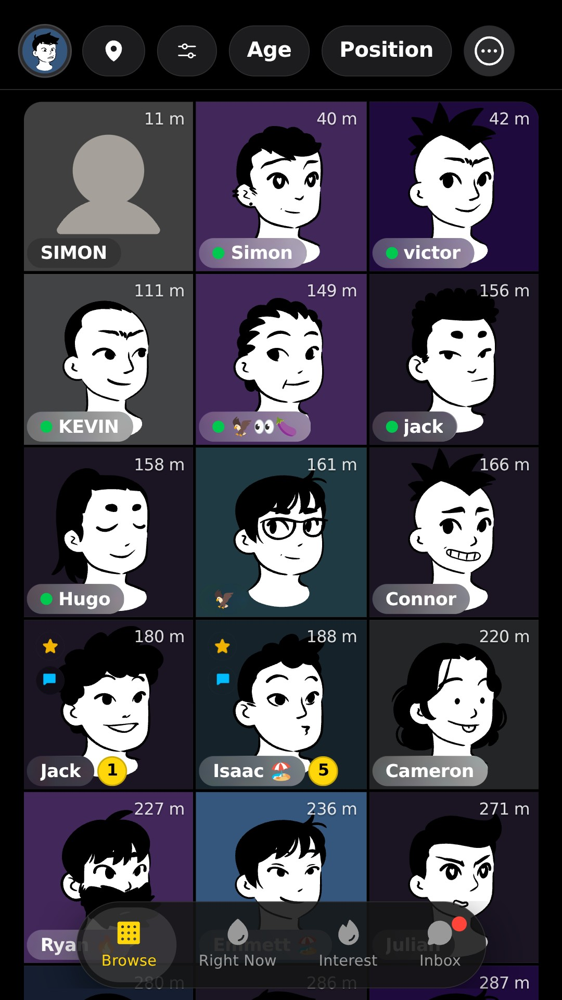
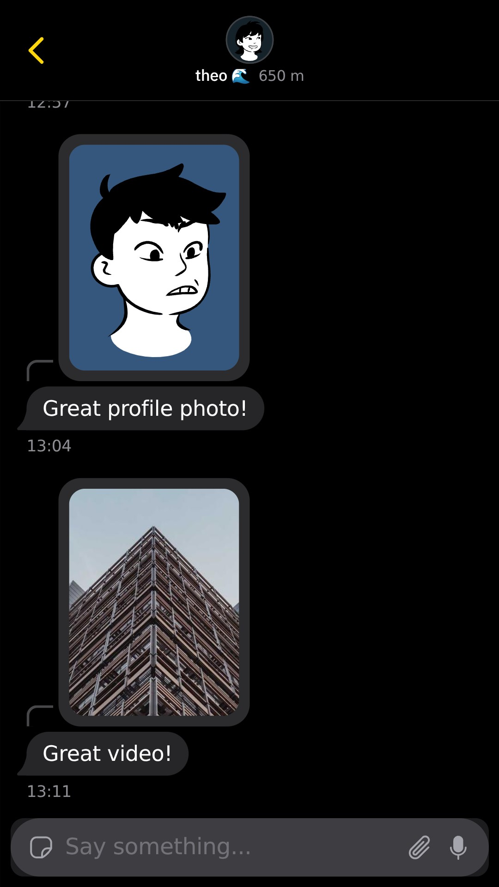
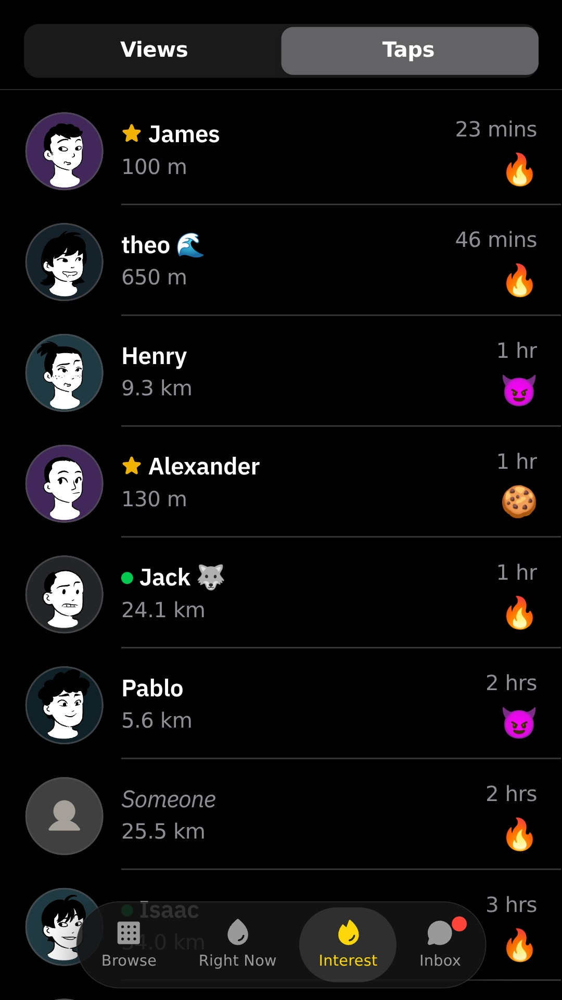
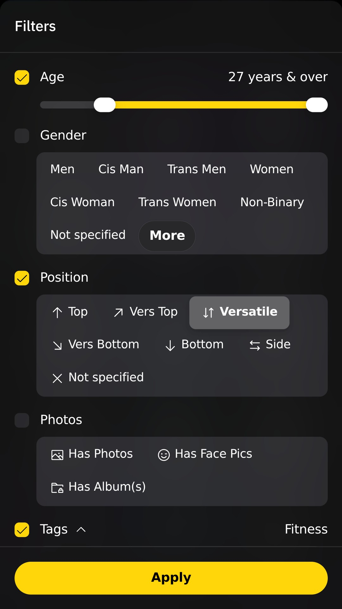
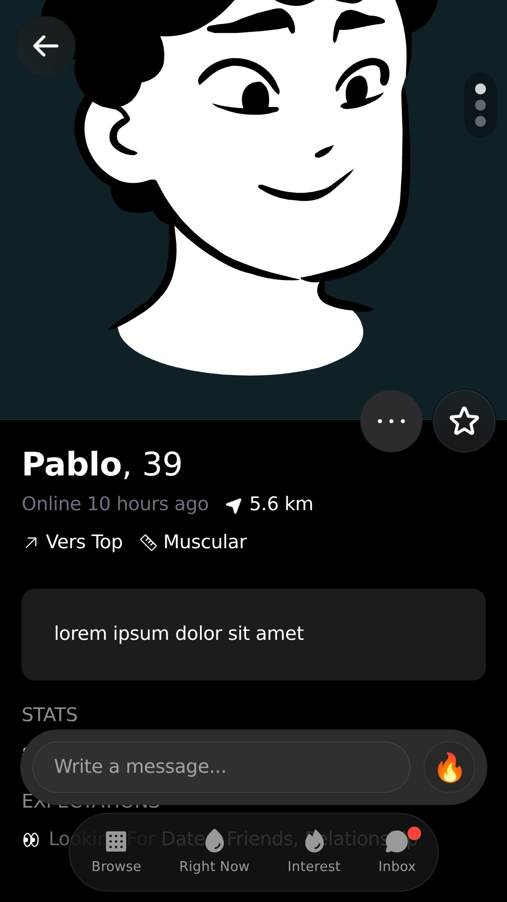
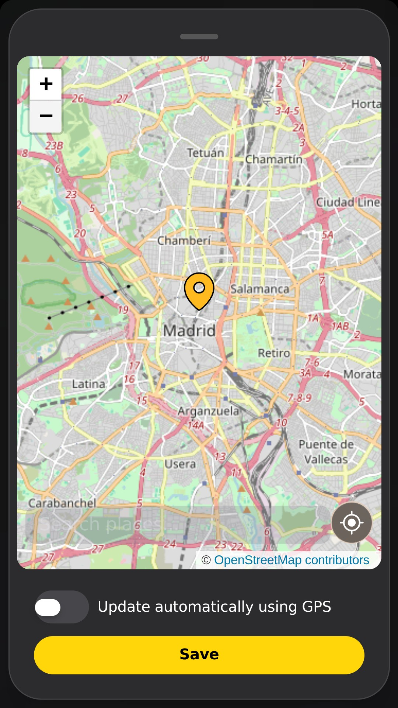

# Open Grind Web

**Open Grind, served from your own server as a web app you add to your iPhone's home screen.**
No Mac, no sideloading, no reinstalling every seven days.

> [!IMPORTANT]
> This is an **unofficial fork** of [Open Grind](https://git.opengrind.org/open-grind/open-grind),
> itself an unofficial Grindr client. It is not affiliated with or endorsed by
> the Open Grind project or by Grindr. For the official Open Grind apps, see
> [opengrind.org](https://opengrind.org).

<table>
	<tr>
		<td></td>
		<td></td>
		<td></td>
	</tr>
	<tr>
		<td></td>
		<td></td>
		<td></td>
	</tr>
</table>

<sub>Demo mode, no real profiles. See <a href="#credits">credits</a> for the media shown.</sub>

## What you get

Everything Open Grind does that a browser can do, plus:

- **A home-screen app on iPhone**: full screen, its own icon, no Safari bars.
- **An iOS look**: system materials, a floating tab bar, Messages-style inbox
  and bubbles, segmented controls, sheets and menus.
- **Right Now**: browse the feed and post, from upstream's work in progress.
- **Filters that fit**: what doesn't fit the bar folds into a "…" menu.
- **Smoother navigation**: tab switches slide, the active tab's highlight
  follows, swipe through every photo of a conversation.
- **Your last message marked** in the inbox (`You:`).
- **Four languages**: English, French, Spanish and German, following your
  device (Settings › App › Language).
- **Photo and video uploads** from the Photos library, with metadata stripped
  as in the desktop app.

## How it works

`og-server`, a small Rust server, hosts the app and talks to Grindr the way
the desktop app does; your phone only ever talks to your server. It sits
behind an **access gate**: a 6-digit code from your authenticator app (iOS
Passwords can fill it in), or a password. Sessions last 30 days.

Details, architecture and every setting: **[WEB.md](./WEB.md)**.

## Set it up

1. **Deploy** with the Pterodactyl egg (`server/pterodactyl/egg-open-grind-web.json`)
   or Docker (`server/Dockerfile`), behind HTTPS (a reverse proxy such as Caddy,
   Nginx Proxy Manager or Traefik).
2. **Scan** the QR code printed in the console on first start with your
   authenticator app.
3. On your iPhone, open your domain in Safari, enter the code, sign in to
   Grindr, then **Share › Add to Home Screen**.

Updating: reinstall (Pterodactyl) or rebuild the image; your data stays.

## Not on the web build

Google and Facebook sign-in, accounts that need reCAPTCHA, push
notifications and HEIC decoding (Safari hands over JPEG, so photos still work).

## Things to know

- Your server holds your Grindr session: keep the gate on and the server
  private.
- Grindr sees your server's IP address, not your phone's. A server at home
  looks more like a phone than one in a data centre.
- Using an unofficial client can go against Grindr's terms; use it at your
  own risk.

## Development

```bash
bun install
OPEN_GRIND_DEMO=1 bunx vite dev   # the app with demo data, no account
cd server && cargo test           # needs cmake and clang (BoringSSL)
```

Upstream changes are merged from the official repository; changes to the
front are kept to a few components so those merges stay easy.

## Credits

Built on [Open Grind](https://git.opengrind.org/open-grind/open-grind) by
the Open Grind Governance and its contributors, and on upstream's Right Now
pull requests.

The screenshots show demo data: avatars in the
[Lorelei](https://www.dicebear.com/styles/lorelei/) style by Lisa Wischofsky
(CC0 1.0), photos from [Lorem Picsum](https://picsum.photos) (Unsplash
License), icons from [Phosphor Icons](https://phosphoricons.com) (MIT), emoji
from [Noto Emoji](https://github.com/googlefonts/noto-emoji) (Apache 2.0) and
map data © [OpenStreetMap contributors](https://www.openstreetmap.org/copyright) (ODbL).

## License

Code: [MIT](./LICENSE). Logo, icons and other artwork from upstream:
[CC0 1.0](https://creativecommons.org/publicdomain/zero/1.0/), see
[ARTWORK.md](./ARTWORK.md).
